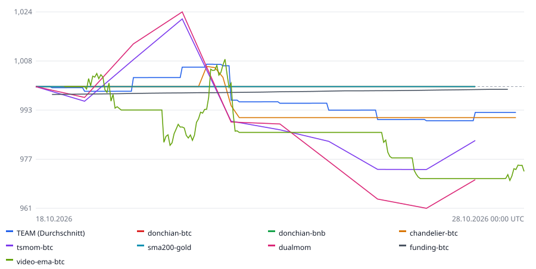

# 📈 Paper-Trading Dashboard

Stand: **18.10.2026 23:03 UTC** · Spielgeld, keine echten Trades · Start je Bot: 1.000,00 €

**Team: 6.997,56 €** (-0,03 % auf 7 Bots) · größter Team-Einbruch: **0.0 %** · Risikostufe: **mutig**

Der Vergleichs-Bot (Strategie aus einem YouTube-Video) zählt nicht zum Team.

📒 **[Trading-Journal](JOURNAL.md)** (Grund jedes Trades) · ✍️ **[Eigene Notizen](NOTIZEN.md)**

| Bot | Strategie | Markt | Konto | Ergebnis | Max. Einbruch | Trades | Treffer | Position | Status |
|---|---|---|---:|---:|---:|---:|---:|---|---|
| donchian-btc | Donchian-Breakout | BTCUSDT | 1.000,00 € | +0,00 % | 0.0 % | 0 | 0 % | Cash | ✅ läuft |
| donchian-bnb | Donchian-Breakout | BNBUSDT | 1.000,00 € | +0,00 % | 0.0 % | 0 | 0 % | Cash | ✅ läuft |
| chandelier-btc | Chandelier-Trend | BTCUSDT | 1.000,00 € | +0,00 % | 0.0 % | 0 | 0 % | Cash | ✅ läuft |
| tsmom-btc | Zeitreihen-Momentum | BTCUSDT | 1.000,00 € | +0,00 % | 0.0 % | 0 | 0 % | Cash | ✅ läuft |
| sma200-gold | 200-Tage-Linie | PAXGUSDT | 1.000,00 € | +0,00 % | 0.0 % | 0 | 0 % | Cash | ✅ läuft |
| dualmom | Dual Momentum | BTCUSDT/ETHUSDT/PAXGUSDT | 1.000,00 € | +0,00 % | 0.0 % | 0 | 0 % | Cash | ✅ läuft |
| funding-btc | Funding-Arbitrage | BTCUSDT | 997,56 € | -0,24 % | 0.0 % | 0 | 0 % | Absicherung aktiv | ✅ läuft |
| video-ema-btc (Vergleich) | EMA 9/21 (YouTube-Vergleich) | BTCUSDT | 1.000,00 € | +0,00 % | 0.0 % | 0 | 0 % | Cash | ✅ läuft |

## Letzte Trades

| Geschlossen | Bot | Einstieg | Ausstieg | Gewinn | Grund |
|---|---|---:|---:|---:|---|
| – | – | – | – | – | noch keine abgeschlossenen Trades |
